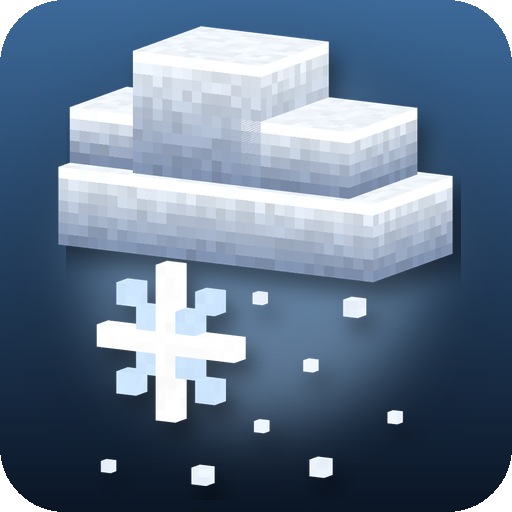
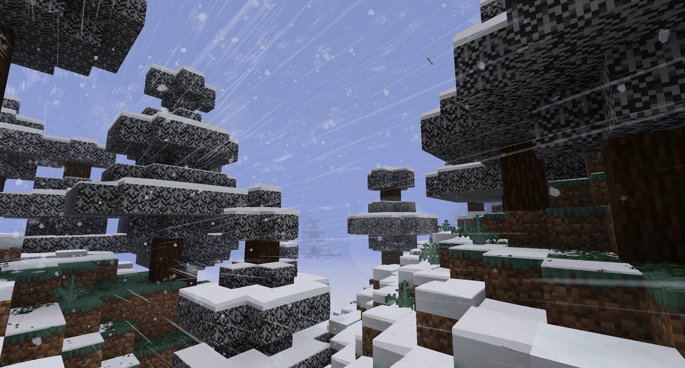

<p align="center">
  
</p>

<h1 align="center">Hoarfrost: Snow &amp; Blizzards</h1>

<p align="center">
  <b>Cosy, realistic snowy weather</b> - seven kinds of snowfall and blizzard, flakes carried by a living wind, soft snow settling on the land and a quiet winter soundscape.
</p>

<p align="center">
  <a href="https://www.curseforge.com/minecraft/mc-mods/hoarfrost-snow-blizzards"></a>
  <a href="https://www.minecraft.net"></a>
  <a href="https://neoforged.net"></a>
  <a href="LICENSE"></a>
</p>

<p align="center">
  
</p>

## Features

- ❄️ **Seven kinds of snow** - light snow, snow, heavy snow, large flakes, light blizzard, blizzard and a whiteout heavy
  blizzard, each with its own flakes, wind, haze and sound, gliding into each other.
- 🌬️ **A living wind** - turns, gusts and lulls, rises over hills and walls, is calm behind them and barely reaches
  under roofs; flakes, crystals, clumps and grains drift with it.
- 🏔️ **Soft snow on the ground** - one smooth cover on land, roofs and crowns, with drifts in the lee, wind-swept ridges
  and caps on fence posts; out to the render distance, melting near lamps.
- 💨 **Snow with physics** - wind charges, explosions, gusts and running feet blow up powder; footprints and trodden
  paths that fresh snow fills again.
- 🌫️ **Storms with volume** - clouds of snow rolling over the land, a bright overcast sky and a blue-grey haze, never
  indoors or underground.
- 🌲 **White leaves in snowy biomes**, as in Bedrock Edition, and real snow drifts piling up when the mod is on the
  server.
- 🔇 **A quiet winter soundscape** - the hush of falling snow, wind growing to a howl, muffled indoors, footsteps
  crunching and squeaking.

## Compatibility

[](https://www.curseforge.com/minecraft/mc-mods/petrichor-rain-storms) ✅ **[Petrichor: Rain & Storms](https://www.curseforge.com/minecraft/mc-mods/petrichor-rain-storms)** (optional) - Petrichor draws the rain, Hoarfrost the snow, both blown by the same wind.

[](https://www.curseforge.com/minecraft/mc-mods/distant-horizons) ✅ **[Distant Horizons](https://www.curseforge.com/minecraft/mc-mods/distant-horizons)** (optional) - the snowy haze covers the distant land too, and far snowy trees stay white.

[](https://www.curseforge.com/minecraft/mc-mods/serene-seasons) ✅ **[Serene Seasons](https://www.curseforge.com/minecraft/mc-mods/serene-seasons)** (optional) - snow falls and lies where the season makes it cold; deep winter brings blizzards.

[](https://modrinth.com/mod/iris) ✅ **[Iris](https://modrinth.com/mod/iris)** (shader packs) - flakes and the snow cover take on the pack's look and lighting.

[](https://modrinth.com/mod/sodium) ✅ **[Sodium](https://modrinth.com/mod/sodium)** - works, white leaves included.

[](https://www.curseforge.com/minecraft/mc-mods/sound-physics-remastered) ✅ **[Sound Physics Remastered](https://www.curseforge.com/minecraft/mc-mods/sound-physics-remastered)** (optional) - the hush of falling snow lets Sound Physics do the muffling.

## Controls

No key bindings. Operators can force the weather for testing:

| Command | Effect |
|---|---|
| `/hoarfrost weather <kind> [seconds]` | Let it snow with a kind (`light_snow`, `snow`, `heavy_snow`, `heavy_large_flakes`, `light_blizzard`, `blizzard`, `heavy_blizzard`), 600 seconds by default. Snow falls where the land is cold; elsewhere it rains. |
| `/hoarfrost weather clear` | Clear weather. |
| `/hoarfrost status` | The kind of snow, the wind, the season and whether it snows where you stand. |

The F3 screen shows the snow, wind and flake counts on the right.

## Crafting

Nothing to craft: the mod has no items.

## Configuration

In the mod list (Mods > Hoarfrost > Config) or in the config files:

- `hoarfrost-client.toml`: quality preset (flake counts, how far snow is simulated and drawn), snowfall on/off,
  flake density, snow in the distance, clouds of snow in storms, the stream of flakes in storms, snow on the ground, snow
  on distant land, snowy leaves, footprints, powder, haze, bright snowy sky, wind volume, hush, snow footsteps.
- `hoarfrost-server.toml` (per world): chances of each kind of snow, thunderstorms as blizzards, following Serene Seasons,
  drifts (on/off, highest drift, growth speed).

## Installation

1. Install [NeoForge](https://neoforged.net) for Minecraft 1.21.1.
2. Put this mod into the `mods` folder (client; on a server too for shared weather and drifts).
3. Optional: [Serene Seasons](https://www.curseforge.com/minecraft/mc-mods/serene-seasons) for seasonal snow,
   [Petrichor](https://www.curseforge.com/minecraft/mc-mods/petrichor-rain-storms) for the rain,
   [Distant Horizons](https://www.curseforge.com/minecraft/mc-mods/distant-horizons) for distant land.

## Building

```sh
./gradlew build
```

The jar is written to `build/libs/`. `./gradlew runGameTestServer` runs the game tests of the snow simulation.

## Credits

- Author: **Pocky**.
- Sounds: field recordings from [Freesound](https://freesound.org), all [CC0](https://creativecommons.org/publicdomain/zero/1.0/),
  cut and mixed by `tools/prepare_sounds.py`:
  - breeze: [a gentle breeze, wind 3](https://freesound.org/s/181252/) by mario1298,
    [Looping Gentle Wind Ambience on an Open Desert Plain](https://freesound.org/s/697217/) by dhallcomposer;
  - wind: [Wind Artic Cold](https://freesound.org/s/117136/) by cobratronik, [Polar Wind](https://freesound.org/s/521820/) by Fission9;
  - storm and gusts: [Wind during snow storm #1](https://freesound.org/s/473815/) by guyburns,
    [Winter storm wind lashing snow](https://freesound.org/s/574552/) by TRP, [gust of wind](https://freesound.org/s/80937/) by Tony B kksm;
  - howl: [Howling winter storm ambient sounds](https://freesound.org/s/505999/) and
    [Howling Wind Ambience](https://freesound.org/s/405601/) by DBlover;
  - footsteps: [snow footsteps](https://freesound.org/s/432285/) by Nimlos, [footsteps in fresh snow](https://freesound.org/s/453168/)
    by florianreichelt, [sfx_snow_footstep-01](https://freesound.org/s/378056/) by bajko,
    [Snow Walking Quiet](https://freesound.org/s/333422/) by MDRivet, [Footsteps in Hard Crunchy Snow](https://freesound.org/s/559459/) by mshahen.
- Textures: drawn by `tools/make_textures.py`.

<!-- more-mods:start -->
## More mods by Pocky

**🌦️ Weather & nature**

<table>
  <tr>
    <td width="56"><a href="https://www.curseforge.com/minecraft/mc-mods/petrichor-rain-storms"></a></td>
    <td><a href="https://www.curseforge.com/minecraft/mc-mods/petrichor-rain-storms"><b>Petrichor: Rain & Storms</b></a> - realistic rain, puddles, drips and branching lightning (<a href="https://github.com/Pocky-l/petrichor">source</a>)</td>
  </tr>
  <tr>
    <td width="56"><a href="https://www.curseforge.com/minecraft/mc-mods/rustling-leaves"></a></td>
    <td><a href="https://www.curseforge.com/minecraft/mc-mods/rustling-leaves"><b>Rustling Leaves</b></a> - falling leaves and leaf piles you can wade through, rake and blow away (<a href="https://github.com/Pocky-l/rustling-leaves">source</a>)</td>
  </tr>
</table>

**💡 Light**

<table>
  <tr>
    <td width="56"><a href="https://www.curseforge.com/minecraft/mc-mods/lumen-rigs"></a></td>
    <td><a href="https://www.curseforge.com/minecraft/mc-mods/lumen-rigs"><b>Lumen Rigs</b></a> - aimable spotlights and floodlights with colored light and visible beams (<a href="https://github.com/Pocky-l/lumen-rigs">source</a>)</td>
  </tr>
  <tr>
    <td width="56"><a href="https://www.curseforge.com/minecraft/mc-mods/neon-glowsticks"></a></td>
    <td><a href="https://www.curseforge.com/minecraft/mc-mods/neon-glowsticks"><b>Neon Glowsticks</b></a> - throwable glowsticks that bounce, roll and light up the dark (<a href="https://github.com/Pocky-l/neon-glowsticks">source</a>)</td>
  </tr>
</table>

**🎨 Graphics & performance**

<table>
  <tr>
    <td width="56"><a href="https://www.curseforge.com/minecraft/mc-mods/turbo-for-distant-horizons"></a></td>
    <td><a href="https://www.curseforge.com/minecraft/mc-mods/turbo-for-distant-horizons"><b>Turbo for Distant Horizons</b></a> - Distant Horizons terrain generated many times faster (<a href="https://github.com/Pocky-l/dhturbo">source</a>)</td>
  </tr>
</table>

**⚔️ Gear & gameplay**

<table>
  <tr>
    <td width="56"><a href="https://www.curseforge.com/minecraft/mc-mods/holy-staff"></a></td>
    <td><a href="https://www.curseforge.com/minecraft/mc-mods/holy-staff"><b>Holy Staff</b></a> - a healing staff with three skills and flying heal numbers (<a href="https://github.com/Pocky-l/holy-staff">source</a>)</td>
  </tr>
  <tr>
    <td width="56"><a href="https://www.curseforge.com/minecraft/mc-mods/ranchers-vacpack"></a></td>
    <td><a href="https://www.curseforge.com/minecraft/mc-mods/ranchers-vacpack"><b>Rancher's Vacpack</b></a> - a Slime Rancher vacuum gun for items and small mobs (<a href="https://github.com/Pocky-l/ranchers-vacpack">source</a>)</td>
  </tr>
</table>

**🛠️ Server tools**

<table>
  <tr>
    <td width="56"><a href="https://www.curseforge.com/minecraft/mc-mods/inventory-backups"></a></td>
    <td><a href="https://www.curseforge.com/minecraft/mc-mods/inventory-backups"><b>Inventory Backups</b></a> - inventory and ender chest backups with one-click restore for admins (<a href="https://github.com/Pocky-l/inventory-backups">source</a>)</td>
  </tr>
</table>

<!-- more-mods:end -->

## License

[MIT](LICENSE)
